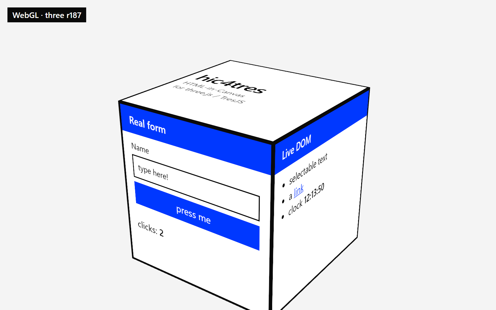
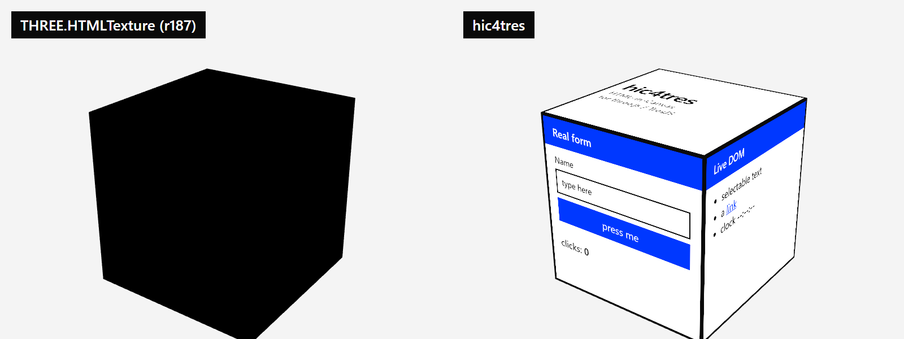
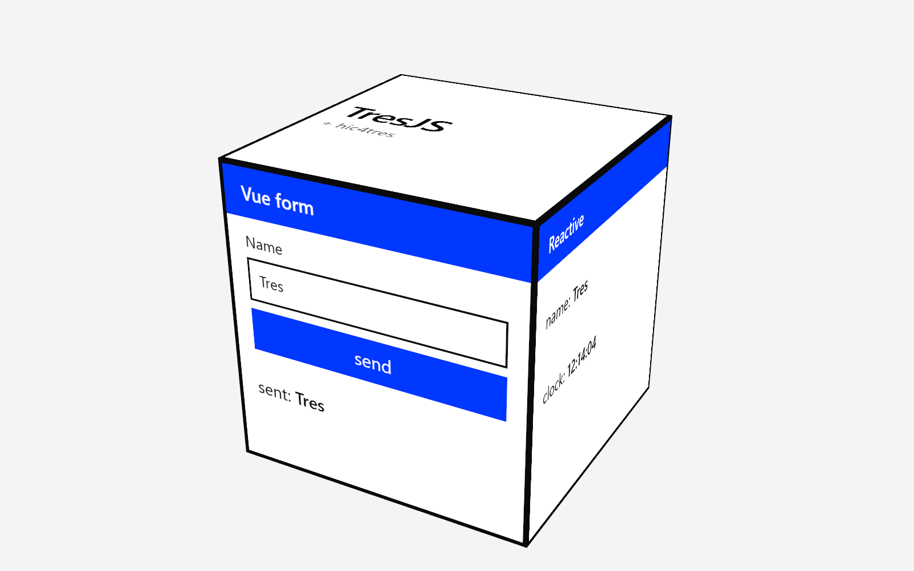
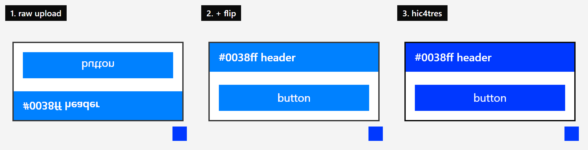
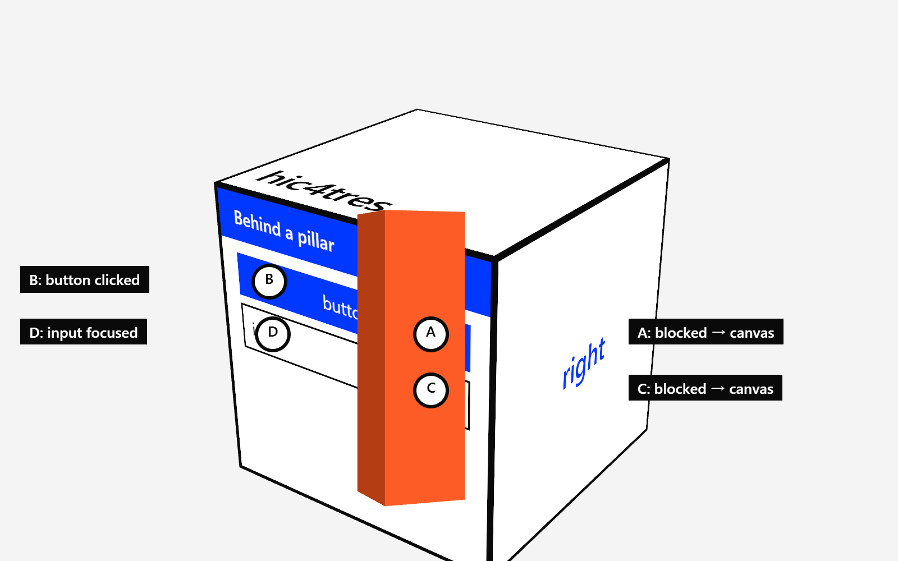

# hic4tres

**HTML-in-Canvas for three.js / TresJS** — put real DOM on 3D planes and keep it interactive.

[日本語](./README.md)

## [▶ Open the live demo](https://shiozaki-shota.github.io/hic4tres/)

In Chrome 157+, every example, including the cube below, runs in your browser.

[](https://shiozaki-shota.github.io/hic4tres/)

The faces of this cube are not pictures: they are real DOM. Click "press me" where it is drawn and it is pressed; click the input and you can type. The clock on the right face ticks, and the texture follows the DOM. As the cube turns, faces looking away from the camera stop taking clicks.

```ts
import { createHtmlCanvas, supportsHtmlInCanvas } from 'hic4tres'

if (supportsHtmlInCanvas()) {
  const hic = createHtmlCanvas(renderer) // a three.js WebGLRenderer
  const mesh = new Mesh(new PlaneGeometry(2, 1.25), new MeshBasicMaterial())
  const layer = hic.add(formElement, { object: mesh })
  mesh.material.map = layer.texture

  renderer.setAnimationLoop(() => {
    mesh.visible = layer.ready // hide until the first texture arrives
    hic.update(camera) // keep hit-testing where the plane is drawn
    renderer.render(scene, camera)
  })
}
```

## Contents

- [Why](#why)
- [How it differs from CSS3DRenderer](#how-it-differs-from-css3drenderer)
- [Features](#features)
- [Requirements](#requirements)
- [Installation](#installation)
- [Usage: three.js](#usage-threejs)
- [Usage: WebGPU](#usage-webgpu)
- [Usage: TresJS / Vue](#usage-tresjs--vue)
- [API](#api)
- [What a straightforward upload looks like](#what-a-straightforward-upload-looks-like)
- [How clicks are handled](#how-clicks-are-handled)
- [Scope and limitations](#scope-and-limitations)
- [Fallback for other browsers](#fallback-for-other-browsers)
- [License](#license)

## Why

The browser's [HTML-in-Canvas API](https://developer.chrome.com/docs/web-platform/html-in-canvas) (shipped in Chrome 157) provides two things separately:

1. **The element's image**: children of `<canvas content="drawable">` can be written into a WebGL texture with `texElementSubImage2D`.
2. **Where it can be clicked**: `updateElementGeometry()` tells the browser where the element is currently drawn on the canvas, so clicks and typing there reach the element.

Where the texture ends up on the canvas is decided by three.js' rendering, and the API does not track it. So for the second one, you have to compute a matrix that matches your camera and pass it in every frame.

three.js has an `HTMLTexture` for this since r184, but as of r187 it targets the earlier origin-trial names (`layoutsubtree`, `texElementImage2D`, and `copyElementImageToTexture` on WebGPU). Shipped Chrome (157+) calls them `content="drawable"`, `texElementSubImage2D` and `drawElementImageToTexture`, so nothing is uploaded and the faces render black. It also never calls `updateElementGeometry`, so even if it drew, clicks would not land where the element is drawn.



*Same cube, same elements: three.js r187 `HTMLTexture` on the left, hic4tres on the right (Chrome 159, WebGL).*

hic4tres targets the shipped API and handles both the texture upload and the hit-testing.

## How it differs from CSS3DRenderer

three.js' `CSS3DRenderer` also puts interactive DOM in 3D space, but in a different way: it lays elements over the canvas with CSS 3D transforms, while hic4tres puts the element's image on a mesh as a texture.

| | `CSS3DRenderer` | hic4tres |
|---|---|---|
| Where the element lives | A DOM layer separate from the canvas, positioned with CSS 3D transforms | Inside the canvas; its image becomes a mesh texture |
| Browsers | All major browsers | Chrome / Chromium 157+ |
| Depth against 3D objects | The whole layer sits in front of or behind the canvas, so out of the box a mesh cannot hide part of an element | Decided by the depth test. A mesh in front hides the element, and clicks on that part go to the canvas |
| Lighting, materials, post-processing | Do not apply to the element | Apply, since it is an ordinary texture |
| Resolution | The browser draws it with the transform applied | A texture at the element's drawn size, so a plane shown much larger than that is upscaled and blurs |
| Planes that always face the camera | `CSS3DSprite` | Not supported |

If it must run in every browser, or the UI just floats in space without overlapping 3D objects, `CSS3DRenderer` is enough. Use hic4tres when elements should be hidden behind 3D objects, or when lighting and post-processing should affect them too. In browsers without HTML-in-Canvas, hic4tres can also switch to `CSS3DRenderer` ([fallback](#fallback-for-other-browsers)).

## Features

- **Hit-testing in sync**: every frame, a 4×4 matrix from the element's coordinates to the canvas is computed from the plane's world matrix and the camera. Orthographic or perspective, tilted or not, you click where it is drawn.
- **Stacking order**: planes are registered from farthest to nearest, so where they overlap, the front element receives the click.
- **Back faces**: planes facing away from the camera (the far side of a turning cube) are taken out of hit-testing.
- **WebGL and WebGPU**: the same API for `WebGLRenderer` and `WebGPURenderer`.
- **Occlusion**: when an ordinary 3D object is in front of an HTML plane, clicks and focus on that part never reach the element and go to the canvas instead ([details](#occlusion)).
- **Texture upload**: on every repaint of the element, reallocating when its size changes.
- **Orientation and colour**: the texture is flipped to three's UV convention and stored as sRGB, so colours match the DOM with three's default colour management.
- **Coexistence**: it listens with `addEventListener('paint')` instead of assigning `canvas.onpaint`, and resets three's GL state cache after its own GL calls.
- **Still the real DOM**: forms, links and text selection work as usual, and the elements stay in the accessibility tree.

## Requirements

| | |
|---|---|
| Browser | Chrome / Chromium 157+ (shipped HTML-in-Canvas; verified in Chrome 159) |
| three | 0.184+ (uses `ExternalTexture`) |
| Vue / TresJS | only for `hic4tres/vue`: vue ^3.5, @tresjs/core ^5 |
| Renderer | `WebGLRenderer`, or `WebGPURenderer` (`three/webgpu`) running on its WebGPU backend |

In other browsers `supportsHtmlInCanvas()` (or `supportsHtmlInCanvas('webgpu')`) returns `false`. With `fallback: 'css3d'`, those browsers still show the elements with `CSS3DRenderer` ([details](#fallback-for-other-browsers)).

## Installation

```bash
npm i hic4tres three

# with TresJS / Vue
npm i hic4tres three vue @tresjs/core
```

`three`, `vue` and `@tresjs/core` are peer dependencies, so install them in your project. `vue` and `@tresjs/core` are only needed for `hic4tres/vue`.

## Usage: three.js

```ts
import { Mesh, MeshBasicMaterial, PlaneGeometry } from 'three'
import { createHtmlCanvas, supportsHtmlInCanvas } from 'hic4tres'

const hic = createHtmlCanvas(renderer)

// 1. The element. Give it a width in CSS (it is laid out inside the canvas).
const card = document.createElement('div')
card.className = 'card' // e.g. width: 340px
card.innerHTML = '<input placeholder="name"><button>send</button>'
card.querySelector('button').addEventListener('click', send)

// 2. A plane, and register the element on it. Match the aspect ratio.
const mesh = new Mesh(new PlaneGeometry(2, 1.25), new MeshBasicMaterial())
scene.add(mesh)
const layer = hic.add(card, { object: mesh })
mesh.material.map = layer.texture

// 3. Every frame
renderer.setAnimationLoop(() => {
  mesh.visible = layer.ready
  hic.update(camera)
  renderer.render(scene, camera)
})
```

Notes:

- **Match the aspect ratio**: if the plane's aspect differs from the element's, the image is stretched (and clicks follow the stretched image). To size the plane in element pixels, scale a `PlaneGeometry(1, 1)` with `mesh.scale.set(el.offsetWidth, el.offsetHeight, 1)` and register it with `hic.add(el, { object: mesh, width: 1, height: 1 })`.
- **`add()` makes the element a child of the canvas**: elements already inside the canvas (for example via Vue's Teleport) are left where they are.
- **Hide until `ready`**: the texture is empty until the first upload.
- **Clean up**: `layer.dispose()` when an element is no longer needed, `hic.dispose()` for everything.

## Usage: WebGPU

Initialise the `WebGPURenderer`, then pass it in; everything else is the same as with WebGL.

```ts
import { WebGPURenderer } from 'three/webgpu'
import { createHtmlCanvas, supportsHtmlInCanvas } from 'hic4tres'

if (supportsHtmlInCanvas('webgpu')) {
  const renderer = new WebGPURenderer({ canvas, antialias: true })
  await renderer.init() // the device must exist first
  const hic = createHtmlCanvas(renderer) // hic.backend === 'webgpu'
  // add / update exactly as with WebGL
}
```


*The same cube drawn with WebGPU. The button and input work the same.*

- Textures are allocated as `rgba8unorm-srgb` and written with `device.queue.drawElementImageToTexture`. Colour and orientation are handled as in the WebGL path.
- A `WebGPURenderer` running on its WebGL2 fallback (no WebGPU available) is not supported; use `WebGLRenderer` there.

## Usage: TresJS / Vue

`<HicCanvas>` is a wrapper you use instead of `<TresCanvas>`. It sets up HTML-in-Canvas and calls `update(camera)` every frame for you.



*After typing "Tres" into the drawn input and pressing send. The right face shows the same `name`, reactively.*

```vue
<!-- App.vue -->
<script setup lang="ts">
import { ref } from 'vue'
import { HicCanvas } from 'hic4tres/vue'
import Scene from './Scene.vue'

const form = ref<HTMLElement | null>(null)
const name = ref('')
</script>

<template>
  <HicCanvas clear-color="#f4f4f4">
    <!-- 3D, as with TresCanvas -->
    <Scene :form="form" />

    <!-- HTML, placed inside the <canvas> as drawable children -->
    <template #html>
      <form ref="form" class="card" @submit.prevent="send">
        <input v-model="name">
        <button>send</button>
      </form>
    </template>
  </HicCanvas>
</template>
```

```vue
<!-- Scene.vue (inside HicCanvas) -->
<script setup lang="ts">
import { shallowRef } from 'vue'
import { useHtmlLayer } from 'hic4tres/vue'
import type { Mesh } from 'three'

const props = defineProps<{ form: HTMLElement | null }>()
const mesh = shallowRef<Mesh>()
const { texture, ready } = useHtmlLayer(() => props.form, { object: mesh })
</script>

<template>
  <TresPerspectiveCamera :position="[0.6, 0.4, 3.6]" :look-at="[0, 0, 0]" />
  <TresMesh ref="mesh" :visible="ready">
    <TresPlaneGeometry :args="[2.2, 1.6]" />
    <TresMeshBasicMaterial :map="texture" />
  </TresMesh>
</template>
```

- Whatever is in the `#html` slot is ordinary Vue: `v-model`, events, reactive rendering. When it re-renders, the texture follows.
- `useHtmlLayer(element, { object })` registers the element once both it and the `HtmlCanvas` exist, and disposes it on unmount. The returned `texture` and `ready` are reactive, so you can bind them in templates. `object` may be a ref that is filled in later.
- `useHic()` returns the `HtmlCanvas` of the nearest `<HicCanvas>` (`null` until ready), in the `#html` slot as well as inside the scene. Use it to call `hic.add()` yourself.
- `HicCanvas` defaults tone mapping to `NoToneMapping` so textures keep their DOM colours; pass `tone-mapping` to override. Every other attribute goes to `TresCanvas`.

For WebGPU, pass a `renderer` function that returns a `WebGPURenderer`. TresJS awaits its `init()`, and `HicCanvas` sets up as soon as the device exists.

```vue
<script setup lang="ts">
import { toValue } from 'vue'
import { WebGPURenderer } from 'three/webgpu'
import type { TresRendererSetupContext } from '@tresjs/core'

const renderer = (ctx: TresRendererSetupContext) =>
  new WebGPURenderer({ canvas: toValue(ctx.canvas), antialias: true, alpha: true })
</script>

<template>
  <HicCanvas :renderer="renderer">…</HicCanvas>
</template>
```

The full example is in [`examples/tres`](./examples/tres). It shows one component per cube face (`FaceMesh.vue`).

## API

### `createHtmlCanvas(renderer, options?) → HtmlCanvas`

Sets the canvas of `renderer` (a `WebGLRenderer`, or a `WebGPURenderer` after `init()`) to `content="drawable"` and creates an `HtmlCanvas`, which registers elements, uploads their textures and updates hit-testing. Throws where HTML-in-Canvas is not available; with `fallback: 'css3d'` it [shows the elements with CSS3DRenderer](#fallback-for-other-browsers) instead.

| Option | Type | Default | Description |
|---|---|---|---|
| `colorSpace` | `'srgb' \| 'linear'` | `'srgb'` | How textures are stored. Use `'linear'` if you disabled three's colour management |
| `occlusion` | `boolean \| OcclusionOptions` | `true` | [Occlusion](#occlusion) handling. `false` turns it off |
| `backfaceHitTest` | `boolean` | `false` | Whether planes seen from behind stay clickable. When `false`, a plane whose front (local +Z) faces away from the camera is taken out of hit-testing |
| `fallback` | `'css3d'` | — | Where HTML-in-Canvas is not available, show the elements with `CSS3DRenderer` instead of throwing |
| `forceFallback` | `boolean` | `false` | Use `CSS3DRenderer` even where HTML-in-Canvas is available (for checks and tests) |

### `HtmlCanvas`

| Member | Description |
|---|---|
| `canvas` | The `<canvas>` |
| `backend` | `'webgl'` or `'webgpu'` (how textures are uploaded), or `'css3d'` in fallback |
| `layers` | The registered `HtmlLayer`s |
| `add(element, { object?, width?, height?, onReady? })` | Registers the element as a drawable child and returns an `HtmlLayer`. `width` / `height` are the element's size on the plane, in the object's local units; by default a `PlaneGeometry`'s size, otherwise 1×1. `onReady` is called once after the first upload |
| `update(camera)` | Call every frame. Updates hit-testing for every layer with an `object`, farthest first (back-facing planes are skipped). Occlusion uses this camera too |
| `dispose()` | Disposes every layer and removes the listeners |

### `HtmlLayer`

| Member | Description |
|---|---|
| `element` | The registered element |
| `texture` | An `ExternalTexture` for a material's `map`, already flipped |
| `ready` | `true` after the first upload |
| `object` / `width` / `height` | Can be changed later |
| `dispose()` | Frees the texture and removes the element from hit-testing (the element itself is not removed) |

### `OcclusionOptions`

| Option | Type | Default | Description |
|---|---|---|---|
| `objects` | `() => Object3D[]` | the scene the planes belong to | What can block an element. A smaller list means cheaper raycasts; clicks reach the element even when an object left out is in front |
| `redispatch` | `boolean` | `true` | Re-send blocked events to the canvas |
| `onBlocked` | `(event, hit) => void` | — | Called for every blocked event; `hit` is the intersection with the object in front |

### Matrix and support utilities

| Function | Description |
|---|---|
| `supportsHtmlInCanvas(backend = 'webgl')` | Whether HTML-in-Canvas (Chrome 157+) is available; pass `'webgpu'` to check the WebGPU path |
| `elementToCanvasMatrix(object, camera, plane, element, canvas, target?)` | A 4×4 matrix (three `Matrix4`) from element CSS px (origin top-left) to canvas CSS px. Holds for perspective cameras too |
| `toDOMMatrix(matrix)` | Converts a `Matrix4` to a `DOMMatrix` for `updateElementGeometry` |
| `projectPoint(matrix, x, y)` | Maps a point on the element to the canvas with that matrix, including the perspective divide. Useful for tests, or for marking where something is drawn |

### `hic4tres/vue`

| Export | Description |
|---|---|
| `<HicCanvas>` | A wrapper of `<TresCanvas>`. `#default` for 3D, `#html` for DOM placed inside the canvas. `hic-options` passes options to `createHtmlCanvas`. The component ref exposes `hic` |
| `useHic()` | `ShallowRef<HtmlCanvas \| null>` |
| `useHtmlLayer(element, { object?, width?, height? })` | `{ layer, texture, ready }`: `layer` is a `ShallowRef<HtmlLayer \| null>`, `texture` and `ready` are reactive. Registers and disposes automatically |

Everything from the core entry is re-exported from `hic4tres/vue` as well.

## What a straightforward upload looks like



*The small square at the bottom right of each is `#0038ff` drawn by three, for comparison.*

1. **Upside down**: the element image comes top row first, while in three's UVs v=0 is the bottom edge (on WebGL and WebGPU alike). hic4tres flips V with the texture's `repeat` and `offset`, so the orientation is right on any geometry with three's standard UVs.
2. **Washed out**: allocated as `RGBA8` (`rgba8unorm` on WebGPU), three's colour management reads the values as linear and encodes them to sRGB again, which brightens them. hic4tres allocates `SRGB8_ALPHA8` (`rgba8unorm-srgb`), so the GPU decodes from sRGB. No need to disable colour management.

## How clicks are handled

### Stacking order

The browser treats the element whose `updateElementGeometry` was called last as topmost. hic4tres calls it from the farthest plane to the nearest every frame, so nearer planes win.

### Occlusion



*A pillar in front of the cube's front face, and the results of clicking A–D.*

The browser decides where a click goes from the element positions alone, without regard to three's meshes, so without help a button behind a pillar can still be pressed.

hic4tres raycasts at the pointer just before an event reaches an element (in the canvas' capture phase). If the nearest hit is an ordinary object rather than an HTML plane:

- the event does not reach the element (`pointerdown` / `mousedown` / `click` / `wheel` and so on);
- `mousedown` and `click` are `preventDefault()`ed, so there is no focus change, text selection or link navigation;
- a copy of the event is dispatched on the canvas itself, so TresJS events or your own canvas listeners can treat it as a click on the object in front. Re-dispatched events have `isTrusted === false`;
- while the pointer rests on the object in front, the element gets `pointer-events: none`. The browser decides the cursor and `:hover` from where the element is, so cancelling events alone would leave e.g. a button's `cursor: pointer`. Meanwhile events go straight to the canvas; once the pointer leaves the object, the element is restored.

## Scope and limitations

| | Status |
|---|---|
| Flat planes in 3D (any position, rotation, scale) | ✅ verified in Chrome 159, including perspective and overlap |
| Shapes made of planes, like a cube (one element per face) | ✅ faces looking away are taken out of hit-testing |
| Orthographic "2D" scenes (UI inside a canvas) | ✅ |
| Vanilla three.js | ✅ `hic4tres` |
| TresJS / Vue | ✅ `hic4tres/vue`, verified in Chrome 159 |
| Occlusion by ordinary meshes in front | ✅ verified in Chrome 159 |
| Curved surfaces (sphere, cylinder…) | draws fine, but **clicks do not line up**: the browser takes one matrix per element, which can only describe a plane (split into one element per flat face, as on the cube) |
| `Sprite` (billboards) | not yet (facing the camera happens on the GPU, not in `matrixWorld`) |
| HTML planes intersecting each other | ordered by the distance of their origins; per-pixel order where they cross is not resolved |
| Cursor and `:hover` of an occluded element | ✅ cleared while the pointer rests on the object in front |
| WebGPU renderer | ✅ verified in Chrome 159 (AMD GPU); not on the WebGL2 fallback |
| Browsers without HTML-in-Canvas | `fallback: 'css3d'` switches to CSS3DRenderer (three.js and TresJS / Vue) |

## Fallback for other browsers

For now HTML-in-Canvas is Chromium-only. With `fallback: 'css3d'`, other browsers do not throw: the elements are laid over the canvas with three.js' `CSS3DRenderer` instead. `add()` and `update()` are used the same way.

```ts
const hic = createHtmlCanvas(renderer, { fallback: 'css3d' })
hic.backend // 'webgl' | 'webgpu', or 'css3d' in other browsers
```

With TresJS / Vue, pass it through `hic-options`. The `#html` slot works as it is.

```vue
<HicCanvas :hic-options="{ fallback: 'css3d' }">…</HicCanvas>
```

When running as `'css3d'`, note how it differs from HTML-in-Canvas:

- The elements live in a layer separate from the canvas and always appear in front of it. Occlusion does not apply, and neither do lighting or post-processing
- `layer.texture` stays empty and `layer.ready` stays `false`. With `mesh.visible = layer.ready` (`:visible="ready"` in Vue), the mesh is hidden and only the element shows
- `layer.dispose()` removes the element from the DOM (as `CSS3DRenderer` does)
- The elements are no longer children of the canvas, so their events do not reach the canvas

`forceFallback: true` uses `'css3d'` even where HTML-in-Canvas is available, for checking how it looks or for tests.

Without `fallback`, `createHtmlCanvas` throws in other browsers. You can still check `supportsHtmlInCanvas()` and provide your own fallback.

## License

[MIT](./LICENSE) © 2026 SHIOZAKI Shota
