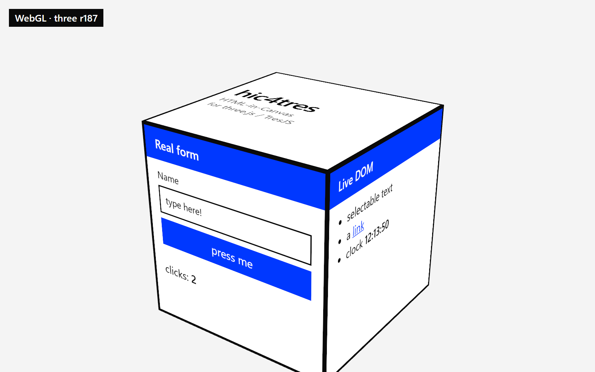
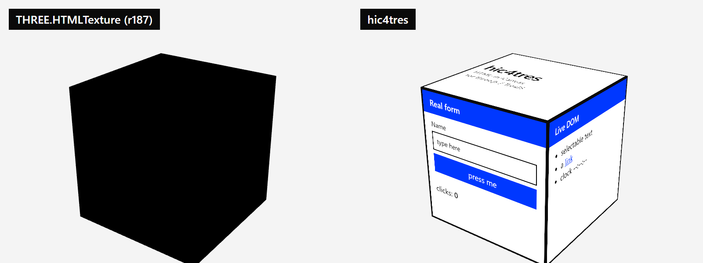
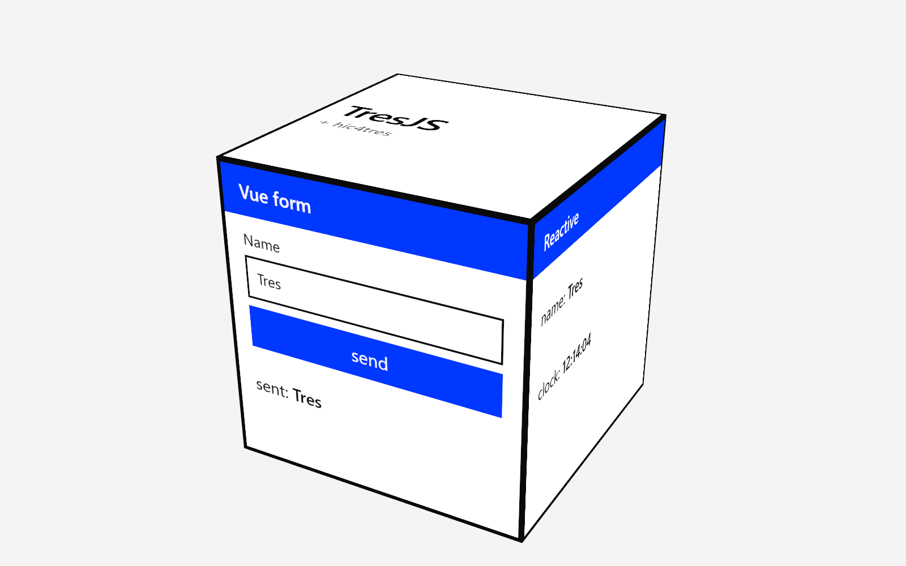
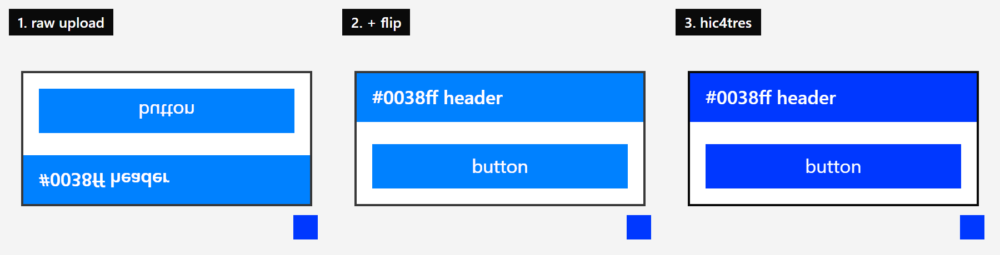
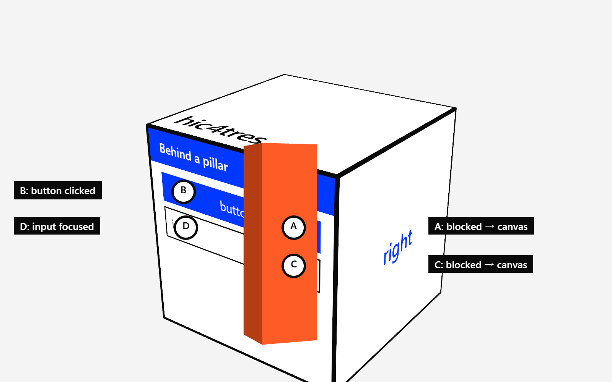

# hic4tres

**HTML-in-Canvas for three.js / TresJS** — 本物のDOMを3Dの板に貼り、そのまま操作できるようにするライブラリ

[English](./README.en.md)

## [▶ ライブデモを開く](https://shiozaki-shota.github.io/hic4tres/)

Chrome 157以降で開くと、下の立方体を含むすべての例をブラウザで操作できます。

[](https://shiozaki-shota.github.io/hic4tres/)

この立方体の各面は画像ではなく、本物のDOMです。前面の「press me」は描かれている位置をクリックすれば押せ、入力欄には文字を打てます。右面の時計はDOMの更新に合わせてテクスチャも進みます。立方体を回すと、裏を向いた面はクリックの対象から外れます。

```ts
import { createHtmlCanvas, supportsHtmlInCanvas } from 'hic4tres'

if (supportsHtmlInCanvas()) {
  const hic = createHtmlCanvas(renderer) // three.jsのWebGLRenderer
  const mesh = new Mesh(new PlaneGeometry(2, 1.25), new MeshBasicMaterial())
  const layer = hic.add(formElement, { object: mesh })
  mesh.material.map = layer.texture

  renderer.setAnimationLoop(() => {
    mesh.visible = layer.ready // 最初のテクスチャが届くまでは隠す
    hic.update(camera) // クリック判定を板の位置に合わせる
    renderer.render(scene, camera)
  })
}
```

## 目次

- [hic4tres](#hic4tres)
  - [目次](#目次)
  - [解決する問題](#解決する問題)
  - [CSS3DRendererとの違い](#css3drendererとの違い)
  - [できること](#できること)
  - [動作環境](#動作環境)
  - [インストール](#インストール)
  - [使い方: three.js](#使い方-threejs)
  - [使い方: WebGPU](#使い方-webgpu)
  - [使い方: TresJS / Vue](#使い方-tresjs--vue)
  - [API](#api)
    - [`createHtmlCanvas(renderer, options?) → HtmlCanvas`](#createhtmlcanvasrenderer-options--htmlcanvas)
    - [`HtmlCanvas`](#htmlcanvas)
    - [`HtmlLayer`](#htmllayer)
    - [`OcclusionOptions`](#occlusionoptions)
    - [行列と判定のユーティリティ](#行列と判定のユーティリティ)
    - [`hic4tres/vue`](#hic4tresvue)
  - [素直に転送したときに起きること](#素直に転送したときに起きること)
  - [クリックの扱い](#クリックの扱い)
    - [重なり順](#重なり順)
    - [遮蔽](#遮蔽)
  - [対応範囲と制約](#対応範囲と制約)
  - [非対応ブラウザへのフォールバック](#非対応ブラウザへのフォールバック)
  - [ライセンス](#ライセンス)

## 解決する問題

ブラウザの[HTML-in-Canvas API](https://developer.chrome.com/docs/web-platform/html-in-canvas)（Chrome 157でGA）は、次の2つを別々に提供します。

1. **要素の画像**: `<canvas content="drawable">`の子に置いた要素を、`texElementSubImage2D`でWebGLのテクスチャに書き込める
2. **クリック判定の位置**: `updateElementGeometry()`で「その要素がいまcanvasのどこに描かれているか」をブラウザに教えると、そこへのクリックや入力が要素に届く

テクスチャがcanvasのどこに描かれるかはthree.jsの描画で決まり、APIはその位置を自動では追跡しません。そのため2つ目については、利用側がカメラに合わせた行列を毎フレーム計算して渡す必要があります。

この2つを扱う実装として、three.jsにもr184から`HTMLTexture`がありますが、r187時点ではオリジントライアル時代のAPI名（`layoutsubtree`、`texElementImage2D`、WebGPUでは`copyElementImageToTexture`）を前提にしています。正式版のChrome（157以降）ではそれぞれ`content="drawable"`、`texElementSubImage2D`、`drawElementImageToTexture`に変わっているため、何も転送されず、面は真っ黒になります。また`updateElementGeometry`を呼ばないので、仮に描けたとしてもクリックは描かれた位置に届きません。



*同じ立方体・同じ要素を、左はthree.js r187の`HTMLTexture`、右はhic4tresで描いたもの（Chrome 159、WebGL）。*

hic4tresは正式版のAPIを対象にし、要素の画像の転送とクリック判定の位置合わせをまとめて行います。

## CSS3DRendererとの違い

three.jsの`CSS3DRenderer`も、DOMを3D空間に置いて操作できるようにします。ただし仕組みが異なります。`CSS3DRenderer`は要素をCSSの3D変形でcanvasに重ね、hic4tresは要素の画像をテクスチャとしてメッシュに貼ります。

| | `CSS3DRenderer` | hic4tres |
|---|---|---|
| 要素の置き場所 | canvasとは別のDOMのレイヤー。CSSの3D変形で位置を合わせる | canvasの中。要素の画像をメッシュのテクスチャにする |
| 対応ブラウザ | 主要ブラウザすべて | Chrome / Chromium 157以降 |
| 3Dの物体との前後関係 | レイヤーごとcanvasの手前か奥に置かれるので、そのままではメッシュが要素の一部を隠せない | 深度テストで前後が決まる。手前のメッシュは要素を隠し、その部分のクリックもcanvasに回る |
| ライティング、マテリアル、ポストエフェクト | 要素には効かない | 普通のテクスチャとして使えるので効く |
| 表示の解像度 | ブラウザが変形込みで描く | 要素の描画サイズのテクスチャを貼るので、板を大きく映すと拡大されてぼやける |
| 常にカメラを向く板 | `CSS3DSprite`がある | 未対応 |

全ブラウザで動かしたい場合や、3Dの物体と重ならないUIを空間に浮かべるだけの場合は`CSS3DRenderer`で足ります。要素を3Dの物体の後ろに隠したい場合や、光や後処理の効果を要素にもかけたい場合はhic4tresを使います。hic4tresは、HTML-in-Canvasに対応していないブラウザでは`CSS3DRenderer`での表示に切り替えることもできます（[フォールバック](#非対応ブラウザへのフォールバック)）。

## できること

- **クリック判定の同期**: 板のワールド行列とカメラから、要素の座標をcanvasの座標に移す4×4行列を毎フレーム計算して渡します。正投影・透視投影のどちらでも、傾いた板でも、描かれた位置でクリックできます。
- **重なり順**: カメラから遠い板から順に登録するので、板が重なっているところでは手前の要素がクリックを受け取ります。
- **裏面**: 裏を向いた板（回っている立方体の奥の面など）はクリック判定から外します。
- **WebGLとWebGPU**: `WebGLRenderer`でも`WebGPURenderer`でも、同じAPIで使えます。
- **遮蔽**: HTMLの板の手前に普通の3Dの物体があるとき、その部分へのクリックやフォーカスを要素に届けず、canvas側に回します（[詳しく](#遮蔽)）。
- **テクスチャの転送**: 要素が描き直されるたびに転送し、要素の大きさが変わればテクスチャを作り直します。
- **向きと色**: テクスチャの上下をthreeのUVに合わせ、sRGBとして保存します。threeの色管理を初期値のまま使っても、DOMと同じ色になります。
- **共存**: `paint`イベントは`addEventListener`で受け取り、`canvas.onpaint`を上書きしません。独自にGLを操作した後はthreeの状態キャッシュをリセットします。
- **本物のDOMのまま**: フォーム、リンク、テキスト選択は通常のDOMと同じように動作し、要素はアクセシビリティツリーにも通常どおり含まれます。

## 動作環境

| | |
|---|---|
| ブラウザ | Chrome / Chromium 157以降（HTML-in-Canvasの正式版。動作確認はChrome 159） |
| three | 0.184以上（`ExternalTexture`を使用） |
| Vue / TresJS | `hic4tres/vue`を使う場合のみ: vue ^3.5、@tresjs/core ^5 |
| レンダラー | `WebGLRenderer`、または`WebGPURenderer`（`three/webgpu`。WebGPUバックエンドで動いているとき） |

非対応ブラウザでは`supportsHtmlInCanvas()`（WebGPUなら`supportsHtmlInCanvas('webgpu')`）が`false`を返します。`fallback: 'css3d'`を指定すれば、非対応ブラウザでも`CSS3DRenderer`で表示できます（[詳しく](#非対応ブラウザへのフォールバック)）。

## インストール

```bash
npm i hic4tres three

# TresJS / Vueで使う場合
npm i hic4tres three vue @tresjs/core
```

`three`、`vue`、`@tresjs/core`はpeerDependenciesなので、利用側でインストールします。`vue`と`@tresjs/core`が必要なのは`hic4tres/vue`を使う場合だけです。

## 使い方: three.js

```ts
import { Mesh, MeshBasicMaterial, PlaneGeometry } from 'three'
import { createHtmlCanvas, supportsHtmlInCanvas } from 'hic4tres'

const hic = createHtmlCanvas(renderer)

// 1. 要素を用意する。幅はCSSで決めておく(canvasの中でレイアウトされる)
const card = document.createElement('div')
card.className = 'card' // 例: width: 340px
card.innerHTML = '<input placeholder="name"><button>send</button>'
card.querySelector('button').addEventListener('click', send)

// 2. 板を作り、要素を登録する。縦横比は要素に合わせる
const mesh = new Mesh(new PlaneGeometry(2, 1.25), new MeshBasicMaterial())
scene.add(mesh)
const layer = hic.add(card, { object: mesh })
mesh.material.map = layer.texture

// 3. 毎フレーム
renderer.setAnimationLoop(() => {
  mesh.visible = layer.ready
  hic.update(camera)
  renderer.render(scene, camera)
})
```

ポイント:

- **縦横比を合わせる**: 板の縦横比が要素の縦横比と違うと、絵が伸びます（クリック位置は伸びた絵に合います）。要素のpxサイズに板を合わせたいときは、`PlaneGeometry(1, 1)`を`mesh.scale.set(el.offsetWidth, el.offsetHeight, 1)`で拡大し、`hic.add(el, { object: mesh, width: 1, height: 1 })`とします。
- **`add()`は要素をcanvasの子にします**: すでにcanvasの中にある要素（VueのTeleportで入れた要素など）は動かしません。
- **`ready`まで隠す**: 最初の転送が済むまで、テクスチャは空です。
- **後片付け**: 要素が不要になったら`layer.dispose()`、全体は`hic.dispose()`を呼びます。

## 使い方: WebGPU

`WebGPURenderer`を初期化してから渡すだけで、残りはWebGLと同じです。

```ts
import { WebGPURenderer } from 'three/webgpu'
import { createHtmlCanvas, supportsHtmlInCanvas } from 'hic4tres'

if (supportsHtmlInCanvas('webgpu')) {
  const renderer = new WebGPURenderer({ canvas, antialias: true })
  await renderer.init() // デバイスができてから
  const hic = createHtmlCanvas(renderer) // hic.backend === 'webgpu'
  // 以降のadd / updateはWebGLと同じ
}
```


*同じ立方体をWebGPUで描いたもの。ボタンと入力欄も同じように操作できます。*

- テクスチャは`rgba8unorm-srgb`で確保し、`device.queue.drawElementImageToTexture`で書き込みます。色と上下の向きの扱いはWebGL版と同じです。
- `WebGPURenderer`がWebGL2のフォールバックで動いている場合（WebGPUが使えない環境）は対象外です。その場合は`WebGLRenderer`を使ってください。

## 使い方: TresJS / Vue

`<HicCanvas>`は`<TresCanvas>`の代わりに使うラッパーです。HTML-in-Canvasの準備と、毎フレームの`update(camera)`を自動で行います。



*描かれた入力欄に「Tres」と打って送信した状態。右面には同じ`name`がリアクティブに表示されています。*

```vue
<!-- App.vue -->
<script setup lang="ts">
import { ref } from 'vue'
import { HicCanvas } from 'hic4tres/vue'
import Scene from './Scene.vue'

const form = ref<HTMLElement | null>(null)
const name = ref('')
</script>

<template>
  <HicCanvas clear-color="#f4f4f4">
    <!-- 3D: TresCanvasと同じ -->
    <Scene :form="form" />

    <!-- HTML: canvasの中へdrawableな子として置かれる -->
    <template #html>
      <form ref="form" class="card" @submit.prevent="send">
        <input v-model="name">
        <button>send</button>
      </form>
    </template>
  </HicCanvas>
</template>
```

```vue
<!-- Scene.vue (HicCanvasの中) -->
<script setup lang="ts">
import { shallowRef } from 'vue'
import { useHtmlLayer } from 'hic4tres/vue'
import type { Mesh } from 'three'

const props = defineProps<{ form: HTMLElement | null }>()
const mesh = shallowRef<Mesh>()
const { texture, ready } = useHtmlLayer(() => props.form, { object: mesh })
</script>

<template>
  <TresPerspectiveCamera :position="[0.6, 0.4, 3.6]" :look-at="[0, 0, 0]" />
  <TresMesh ref="mesh" :visible="ready">
    <TresPlaneGeometry :args="[2.2, 1.6]" />
    <TresMeshBasicMaterial :map="texture" />
  </TresMesh>
</template>
```

- `#html`スロットの中身は、Vueのコンポーネントとして通常どおり動きます（`v-model`、イベント、リアクティブな表示）。描き直されると、テクスチャも自動で更新されます。
- `useHtmlLayer(要素, { object })`は、要素と`HtmlCanvas`の両方がそろった時点で登録し、アンマウント時に破棄します。戻り値の`texture`と`ready`はリアクティブなので、テンプレートにそのまま渡せます。`object`は後から決まるrefでも構いません。
- `useHic()`は最も近い`<HicCanvas>`の`HtmlCanvas`を返します（準備ができるまでは`null`）。`#html`スロットの中でも、シーンの中でも使えます。`hic.add()`を直接呼びたいときに使います。
- `HicCanvas`はトーンマッピングの初期値を`NoToneMapping`にします（テクスチャをDOMと同じ色で出すため）。`tone-mapping`を渡せば上書きできます。それ以外の属性はそのまま`TresCanvas`に渡ります。

WebGPUで動かすときは、`renderer`に`WebGPURenderer`を返す関数を渡します。TresJSが`init()`を待ち、`HicCanvas`はデバイスができた時点で準備します。

```vue
<script setup lang="ts">
import { toValue } from 'vue'
import { WebGPURenderer } from 'three/webgpu'
import type { TresRendererSetupContext } from '@tresjs/core'

const renderer = (ctx: TresRendererSetupContext) =>
  new WebGPURenderer({ canvas: toValue(ctx.canvas), antialias: true, alpha: true })
</script>

<template>
  <HicCanvas :renderer="renderer">…</HicCanvas>
</template>
```

完全な例は[`examples/tres`](./examples/tres)にあります。立方体の1面を1コンポーネント（`FaceMesh.vue`）にした書き方の見本になっています。

## API

### `createHtmlCanvas(renderer, options?) → HtmlCanvas`

`renderer`（`WebGLRenderer`、または`init()`済みの`WebGPURenderer`）のcanvasを`content="drawable"`にし、要素の登録、テクスチャの転送、クリック判定の更新を行う`HtmlCanvas`を作ります。非対応の環境では例外を投げます。`fallback: 'css3d'`を指定すれば、代わりに[CSS3DRendererで表示](#非対応ブラウザへのフォールバック)します。

| オプション | 型 | 初期値 | 説明 |
|---|---|---|---|
| `colorSpace` | `'srgb' \| 'linear'` | `'srgb'` | テクスチャの保存形式。threeの色管理を切っている場合は`'linear'` |
| `occlusion` | `boolean \| OcclusionOptions` | `true` | [遮蔽](#遮蔽)の判定。`false`で無効 |
| `backfaceHitTest` | `boolean` | `false` | 裏を向いた板もクリックできるようにするか。`false`のときは、板の表（ローカル+Z）がカメラと反対を向くとクリック判定から外す |
| `fallback` | `'css3d'` | — | HTML-in-Canvasが使えないとき、例外を投げずに`CSS3DRenderer`で表示する |
| `forceFallback` | `boolean` | `false` | 対応ブラウザでも`CSS3DRenderer`で表示する（確認・テスト用） |

### `HtmlCanvas`

| メンバー | 説明 |
|---|---|
| `canvas` | 対象の`<canvas>` |
| `backend` | `'webgl'`か`'webgpu'`（テクスチャの転送に使っている方式）、またはフォールバック時の`'css3d'` |
| `layers` | 登録中の`HtmlLayer`の集合 |
| `add(element, { object?, width?, height?, onReady? })` | 要素をdrawableな子として登録し、`HtmlLayer`を返す。`width` / `height`は板の上での要素の大きさ（`object`のローカル単位）。省略時は`object`が`PlaneGeometry`ならその大きさ、それ以外は1×1。`onReady`は最初の転送が済んだときに1回呼ばれる |
| `update(camera)` | 毎フレーム呼ぶ。`object`を持つ全レイヤーのクリック判定を、カメラから遠い順に更新する（裏を向いた板は外す）。遮蔽の判定にもこのカメラを使う |
| `dispose()` | すべてのレイヤーとイベントリスナーを片付ける |

### `HtmlLayer`

| メンバー | 説明 |
|---|---|
| `element` | 登録した要素 |
| `texture` | マテリアルの`map`に使う`ExternalTexture`。上下反転済み |
| `ready` | 最初の転送が済んだら`true` |
| `object` / `width` / `height` | 後から変更できる |
| `dispose()` | テクスチャを破棄し、クリック判定から外す（要素自体は削除しない） |

### `OcclusionOptions`

| オプション | 型 | 初期値 | 説明 |
|---|---|---|---|
| `objects` | `() => Object3D[]` | 板が属するシーン全体 | 遮蔽物になりうる物。範囲を絞るとレイキャストが軽くなる。ここに含めない物が手前にあっても、クリックは要素に届く |
| `redispatch` | `boolean` | `true` | 遮ったイベントをcanvasに送り直す |
| `onBlocked` | `(event, hit) => void` | — | 遮ったイベントごとに呼ばれる。`hit`は手前にあった物の交差情報 |

### 行列と判定のユーティリティ

| 関数 | 説明 |
|---|---|
| `supportsHtmlInCanvas(backend = 'webgl')` | Chrome 157以降のHTML-in-Canvasが使えるか。`'webgpu'`を渡すとWebGPU版を確認する |
| `elementToCanvasMatrix(object, camera, plane, element, canvas, target?)` | 要素のCSS px（左上原点）をcanvasのCSS pxに移す4×4行列（threeの`Matrix4`）。透視投影でも成り立つ |
| `toDOMMatrix(matrix)` | `Matrix4`を`updateElementGeometry`に渡せる`DOMMatrix`に変換する |
| `projectPoint(matrix, x, y)` | 上の行列で要素上の点をcanvas上の点に移す（透視除算込み）。テストや、描かれた位置に印を付けるときに使う |

### `hic4tres/vue`

| エクスポート | 説明 |
|---|---|
| `<HicCanvas>` | `<TresCanvas>`のラッパー。`#default`に3D、`#html`にcanvasの中へ置くDOM。`hic-options`で`createHtmlCanvas`のオプションを渡せる。`ref`から`hic`を取れる |
| `useHic()` | `ShallowRef<HtmlCanvas \| null>` |
| `useHtmlLayer(element, { object?, width?, height? })` | `{ layer, texture, ready }`。`layer`は`ShallowRef<HtmlLayer \| null>`、`texture`と`ready`はリアクティブ。登録と破棄を自動で行う |

`hic4tres/vue`からは、コアのエクスポートもすべて使えます。

## 素直に転送したときに起きること



*右下の小さな四角は、threeが`#0038ff`で描いた比較用の色見本です。*

1. **上下が逆さまになる**: 要素の画像は上の行から順に並びますが、threeのUVではv=0が下端です（WebGLでもWebGPUでも同じ）。hic4tresはテクスチャの`repeat`と`offset`でV方向を反転させます。threeの標準的なUVを持つ形状なら、どれに貼っても向きが合います。
2. **色が薄くなる**: `RGBA8`（WebGPUでは`rgba8unorm`）で確保すると、threeの色管理がその値をリニアとみなしてsRGBに変換するため、明るくなります。hic4tresは`SRGB8_ALPHA8`（`rgba8unorm-srgb`）で確保し、GPUにsRGBから戻させます。threeの色管理を切る必要はありません。

## クリックの扱い

### 重なり順

ブラウザは「最後に`updateElementGeometry`を呼んだ要素」を一番上として扱います。hic4tresは毎フレーム、カメラから遠い板から順に呼ぶので、手前の板が上になります。

### 遮蔽



*立方体の前面の手前に柱を置き、A〜Dをクリックした結果。*

ブラウザは要素の位置だけでクリック先を決めるので、threeのメッシュによる遮りは考慮されません。そのため、何もしないと柱の後ろに隠れたボタンでも押せてしまいます。

hic4tresは、要素にイベントが届く直前（canvasのcapture段階）にポインタの位置へレイを飛ばします。一番手前に当たったのがHTMLの板ではない普通の物体なら、次のように振る舞います。

- イベントを要素に届けない（`pointerdown` / `mousedown` / `click` / `wheel`など）
- `mousedown`と`click`は`preventDefault()`するので、フォーカスの移動、テキスト選択、リンクの遷移も起きない
- 同じ内容のイベントをcanvas自身に送り直す。TresJSのイベントや、利用側がcanvasに付けたリスナーが「手前の物体がクリックされた」として扱える。送り直したイベントは`isTrusted`が`false`になる
- ポインタが手前の物体の上にある間は、要素を`pointer-events: none`にする。カーソルの形と`:hover`はブラウザが要素の位置から決めるので、イベントを止めるだけではボタンの`cursor: pointer`などが残る。この間のイベントは最初からcanvasに届き、ポインタが物体から外れると要素は元に戻る

## 対応範囲と制約

| 項目 | 状態 |
|---|---|
| 3D空間の平らな板（位置・回転・拡大縮小は自由） | ✅ Chrome 159で確認（透視投影・重なりを含む） |
| 立方体のように板を組み合わせた形（面ごとに1要素） | ✅ 裏を向いた面はクリック判定から外す |
| 正投影の「2D」画面（canvas内のUI） | ✅ |
| 素のthree.js | ✅ `hic4tres` |
| TresJS / Vue | ✅ `hic4tres/vue`。Chrome 159で確認 |
| 手前の普通のメッシュによる遮蔽 | ✅ Chrome 159で確認 |
| 曲面（球・円柱など）に貼る | 描画はできるが、**クリック位置は合わない**。ブラウザが1要素に受け取れる行列は1つで、平面しか表せないため（立方体のように面ごとに要素を分ければよい） |
| `Sprite`（常にカメラを向く板） | 未対応（カメラへの向きはGPU側で付くので、`matrixWorld`に現れない） |
| HTMLの板どうしが交差している場合 | 板の中心の距離で順番を決める。交差した部分のピクセル単位の前後は解決しない |
| 遮られている要素のカーソルと`:hover` | ✅ ポインタが手前の物体の上にある間は外れる |
| WebGPUのレンダラー | ✅ Chrome 159（AMDのGPU）で確認。WebGL2フォールバック時は対象外 |
| 非対応ブラウザ | `fallback: 'css3d'`でCSS3DRendererによる表示に切り替える（three.js、TresJS / Vueとも） |

## 非対応ブラウザへのフォールバック

HTML-in-Canvasが使えるのは今のところChromium系だけです。`fallback: 'css3d'`を指定すると、非対応ブラウザでは例外を投げる代わりに、three.jsの`CSS3DRenderer`で要素をcanvasに重ねて表示します。`add()`と`update()`の使い方は変わりません。

```ts
const hic = createHtmlCanvas(renderer, { fallback: 'css3d' })
hic.backend // 'webgl' | 'webgpu'、非対応ブラウザでは 'css3d'
```

TresJS / Vueでは`hic-options`で渡します。`#html`スロットの中身はそのまま使えます。

```vue
<HicCanvas :hic-options="{ fallback: 'css3d' }">…</HicCanvas>
```

`'css3d'`で動いているときは、HTML-in-Canvasとの違いとして次の点に注意してください。

- 要素はcanvasとは別のレイヤーに置かれ、常にcanvasの手前に表示されます。遮蔽は効かず、ライティングや後処理も要素にはかかりません
- `layer.texture`は空のままで、`layer.ready`は`false`のままです。`mesh.visible = layer.ready`（Vueでは`:visible="ready"`）と書いていれば、メッシュは隠れて要素だけが見えます
- `layer.dispose()`は要素をDOMから取り除きます（`CSS3DRenderer`の仕様）
- 要素はcanvasの子ではなくなるので、要素で起きたイベントはcanvasには伝わりません

`forceFallback: true`を指定すると、対応ブラウザでも`'css3d'`で動きます。見た目の確認やテストに使えます。

`fallback`を指定しない場合、非対応ブラウザでは`createHtmlCanvas`が例外を投げます。`supportsHtmlInCanvas()`で判定して、代替表示を自分で用意することもできます。

## ライセンス

[MIT](./LICENSE) © 2026 SHIOZAKI Shota
